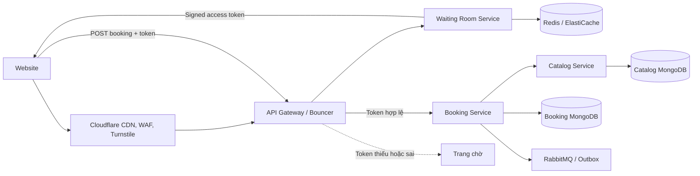

# Kiến trúc Virtual Waiting Room

Bản vẽ đầy đủ theo phong cách cloud architecture nằm tại [tài liệu sơ đồ tổng thể](../technical/ARCHITECTURE_DIAGRAM.md), kèm PNG và SVG.

## Trách nhiệm

- Cloudflare giảm DDoS/bot traffic nhưng không lưu trạng thái hàng chờ.
- Waiting Room Service sở hữu FIFO queue, active checkout lease và admission rate trong Redis.
- API Gateway xác minh chữ ký, TTL và owner của access token.
- Booking Service bảo đảm một admission chỉ tạo một booking và đối chiếu event thật sau khi catalog reserve.
- Catalog Service dùng atomic inventory làm lớp chống oversell cuối cùng.

## Trạng thái chính

`waiting -> admitted -> used/expired`

- `waiting`: client nhận vị trí, ETA và `retryAfterSeconds`.
- `admitted`: client nhận access token ngắn hạn; entry chiếm một active slot.
- `used`: unique index `security.waitingRoomEntryId` ngăn token tạo booking lần hai.
- `expired`: active lease hết hạn; client phải join lại.

## Sự cố và hành vi

- Redis lỗi: waiting-room readiness chuyển `DOWN`, luồng mua vé fail-closed.
- Waiting Room Service restart: pod mới đọc lại queue từ Redis, không mất thứ tự.
- Token bị sửa/hết hạn/sai user: Gateway trả `403`.
- Không có token khi waiting room bật: Gateway trả `428`.
- Inventory hết dù đã admission: Catalog từ chối reserve; admission không phải cam kết còn vé.
