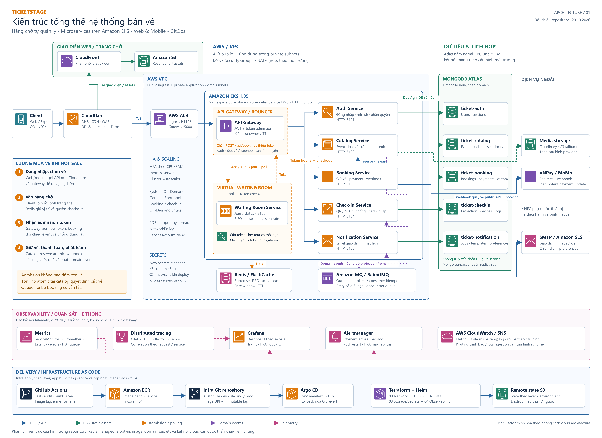

# Sơ đồ kiến trúc TicketStage

Sơ đồ tổng thể được vẽ theo phong cách cloud architecture của ảnh tham khảo: icon dịch vụ màu, ranh giới hệ thống, khung admission nét đứt và mũi tên phân biệt các luồng. Nhãn tiếng Việt; tên sản phẩm và service giữ nguyên để đối chiếu với source code.



## File xuất

### Các hình chi tiết bổ sung

| Nội dung | Ảnh báo cáo | Vector |
| --- | --- | --- |
| AZ, subnet, NAT, ALB, node groups, data plane chung | [PNG 3900 × 3090](diagrams/ticketstage-availability-zones.png) | [SVG](diagrams/ticketstage-availability-zones.svg) |
| Cấp và phân phối admission token qua nhiều pod/AZ | [PNG 3900 × 3675](diagrams/ticketstage-token-distribution.png) | [SVG](diagrams/ticketstage-token-distribution.svg) |

Xem [giải thích chi tiết AZ và token](AZ_AND_TOKEN_FLOWS.md) để đọc cấu trúc Redis, JWT claims, thời hạn và các giới hạn thực tế của implementation.

### Hình tổng thể

- [PNG độ phân giải cao, 4200 × 3060](diagrams/ticketstage-architecture.png): dùng trong báo cáo, slide và in.
- [SVG vector](diagrams/ticketstage-architecture.svg): phóng to không vỡ hình; chỉnh sửa bằng Inkscape hoặc công cụ vector hỗ trợ SVG.
- [PNG xem nhanh, 1800 × 1311](diagrams/ticketstage-architecture-preview.png).
- [Source tạo sơ đồ](diagrams/render-architecture.mjs): chỉnh tọa độ, nhãn, icon và đường nối rồi xuất lại.

Icon là hình vector minh họa tự dựng theo nhóm chức năng, không phải bộ logo AWS chính thức. Sơ đồ mô tả cấu hình kiến trúc trong repository tại thời điểm vẽ; không xác nhận các tài nguyên AWS đã được apply hoặc các luồng đã chạy end-to-end.

## Cách đọc sơ đồ

1. **Client và edge:** Web/Expo gọi API qua Cloudflare, ALB và gateway. Web tĩnh được phân phối từ CloudFront/S3. Waiting page thuộc frontend hiện có, không phải một ứng dụng Lambda độc lập.
2. **Admission:** frontend/mobile join và poll `waiting-room-service` qua gateway. Service lưu FIFO, active lease và rate window trên Redis, trả admission token để client gửi cùng request tạo booking. Các nhánh giữa gateway và waiting room thể hiện luồng logic của client; gateway trả `428`/`403`, không tự chuyển trang trình duyệt.
3. **Nghiệp vụ:** gateway định tuyến đến auth, catalog, booking, check-in và notification. Catalog sở hữu tồn kho. Booking gọi catalog qua internal API để reserve/release và xử lý thanh toán; admission không phải bảo đảm còn vé.
4. **Dữ liệu:** mỗi domain sở hữu một database MongoDB riêng. Các database có thể cùng nằm trên một cluster Atlas; sơ đồ không yêu cầu năm cluster riêng. Mongo transactions cần replica set. Waiting room dùng Redis và không có database MongoDB riêng.
5. **Sự kiện:** outbox và RabbitMQ truyền domain events đến consumer, bao gồm projection check-in và notification. Các nhánh màu tím là bus logic cho những producer/consumer liên quan; không có nghĩa mọi service publish hoặc subscribe tất cả event.
6. **Đối tác:** booking tạo phiên VNPay/MoMo; webhook của nhà cung cấp quay lại public API, qua gateway đến booking. Notification gửi email qua provider SMTP/SES được cấu hình. Media storage dùng Cloudinary/S3 theo chế độ được chọn.
7. **Vận hành:** Prometheus thu metrics; OTel Collector/Tempo thu trace; Grafana truy vấn dữ liệu quan sát; Prometheus chuyển alert đến Alertmanager. CloudWatch/SNS là nhóm giám sát AWS riêng. Log groups và cấu hình exporter không tự chứng minh log ingestion đang hoạt động.
8. **Triển khai:** GitHub Actions build/scan/push image riêng cho từng service, rồi cập nhật URI/tag vào repo infra. Argo CD sync manifest vào EKS. Mũi tên ECR → infra biểu diễn việc CI ghi image reference, không phải ECR tự sửa Git. Terraform quản lý hạ tầng theo layer và lưu remote state S3.

## Ranh giới so với ảnh tham khảo

| Khối trong mẫu | Thành phần TicketStage |
| --- | --- |
| CDN / edge | Cloudflare; CloudFront/S3 phục vụ web tĩnh |
| API Gateway + Lambda bouncer | Node.js `api-gateway` chạy trong EKS |
| Waiting Room Application | Giao diện checkout chờ + `waiting-room-service` |
| FIFO / admission state | Redis hoặc Amazon ElastiCache |
| DynamoDB | Không dùng cho luồng waiting room hiện tại |
| Timestream | Không dùng; metrics/trace qua stack observability |
| Main Ticketing Application | Web/mobile + các domain microservice |

## Điều kiện triển khai cần giữ đúng

- `WAITING_ROOM_ENABLED=true` cần Redis hoạt động. ElastiCache là module opt-in; phải bật hoặc cấp Redis phù hợp trước khi kiểm thử admission.
- Gateway và waiting room phải dùng cùng signing secret. Runtime Secret Kubernetes cần được nạp; sơ đồ không giả định đã có External Secrets tự đồng bộ từ Secrets Manager.
- Image URI, domain, TLS certificate, database URI, credentials và kết nối mạng cần cấu hình theo môi trường thực.
- HTTP service-to-service hiện được thể hiện đúng theo code; sơ đồ không khẳng định đã triển khai mTLS/service mesh.
- HPA scale pod; Cluster Autoscaler scale node khi được bật/cấu hình. Booking/check-in được gán node On-Demand critical; general workloads dùng pool phù hợp với selector.
- QR/NFC phụ thuộc nền tảng mobile và phần cứng. Admission token khác access token đăng nhập và khác payload vé.
- Alert/dashboard trên hình mô tả các nhóm quan sát hệ thống; không khẳng định đã có metric chi tiết FIFO hay dashboard waiting-room chuyên biệt.

## Nguồn đối chiếu

- [`backend/shared/serviceTopology.js`](../../backend/shared/serviceTopology.js): tên service, port và Dockerfile.
- [`backend/microservices/api-gateway/server.js`](../../backend/microservices/api-gateway/server.js): định tuyến và admission gate.
- [`backend/services/waiting-room/src/waitingRoomService.js`](../../backend/services/waiting-room/src/waitingRoomService.js): FIFO, lease, admission và token.
- [`frontend/src/pages/Checkout.tsx`](../../frontend/src/pages/Checkout.tsx), [`mobile/src/App.js`](../../mobile/src/App.js): join/poll và checkout.
- Repo `ticket-infra`, thư mục `k8s/base`: Service, Deployment, NetworkPolicy, HPA, PDB, ServiceMonitor và alert.
- Repo `ticket-infra`, thư mục `aws/terraform/layers`: networking, EKS, data, storage/secrets và observability.
- [API và luồng thực thi](API_AND_FLOWS.md), [hạ tầng và chi phí](INFRASTRUCTURE_AND_COST.md).

## Xuất lại

Chạy từ thư mục `ticket-booking-app`:

```powershell
node docs/technical/diagrams/render-architecture.mjs
```

Lệnh trên tạo lại SVG và không cần cài dependency của app. Muốn xuất thêm PNG, truyền đường dẫn đến package `@resvg/resvg-js` đã cài riêng:

```powershell
node docs/technical/diagrams/render-architecture.mjs D:/ticket/.tmp-ci/diagram-tools/node_modules/@resvg/resvg-js
```

PNG có nền trắng để dễ chèn vào tài liệu. Chữ và icon nằm trong SVG; PNG là bản raster xuất từ cùng source.

Xuất lại hai hình chi tiết:

```powershell
node docs/technical/diagrams/render-architecture-details.mjs D:/ticket/.tmp-ci/diagram-tools/node_modules/@resvg/resvg-js
```
