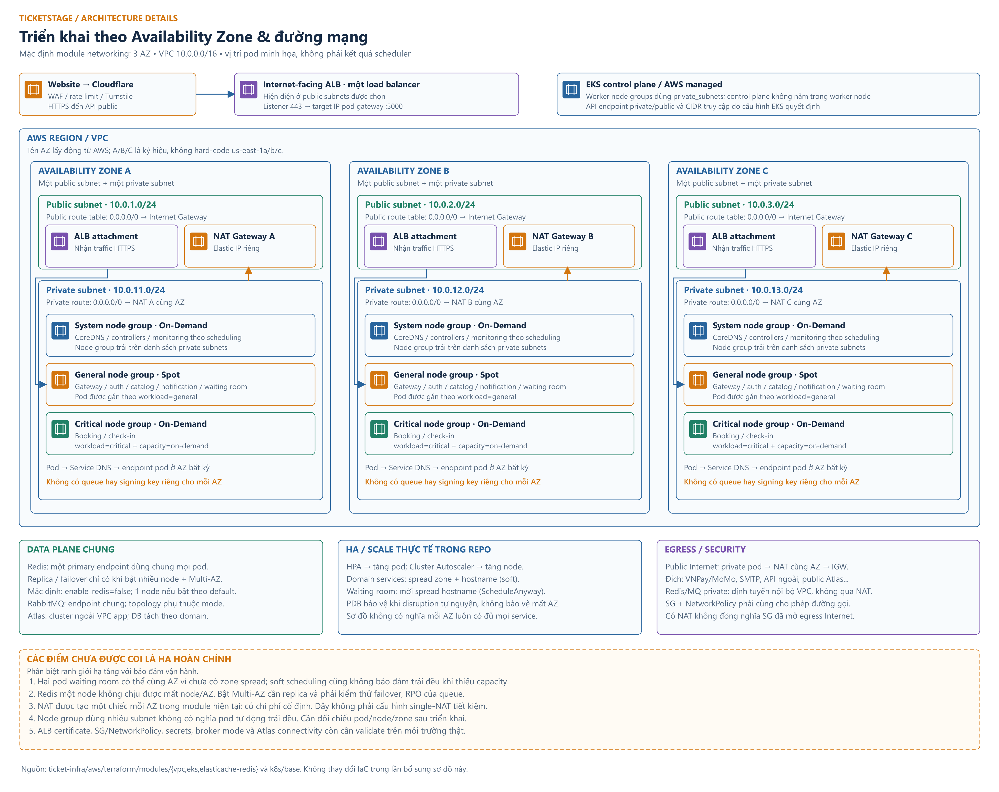
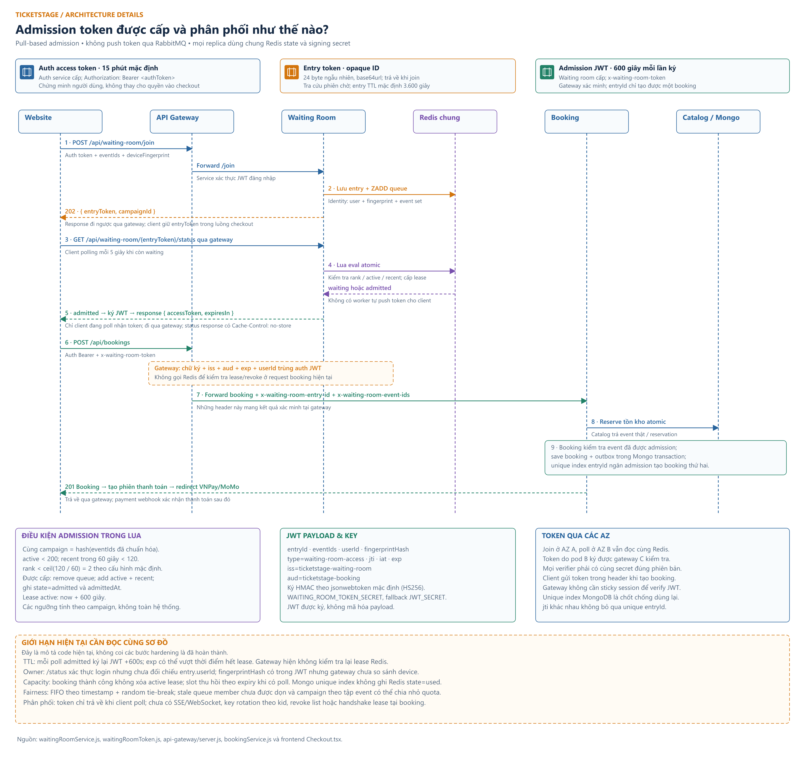

# Availability Zone và phân phối token

Tài liệu đi kèm hai bản vẽ chi tiết của TicketStage. Các giá trị dưới đây lấy từ code và default Terraform/ConfigMap trong repository. `tfvars`, secret và manifest sau deploy có thể ghi đè default; không suy ra trạng thái cloud đang chạy từ hình minh họa.

## 1. Region, VPC và Availability Zone



Layer `00-networking` mặc định dùng region `us-east-1`, VPC `10.0.0.0/16`. Layer chọn những AZ đầu tiên trong kết quả `aws_availability_zones.available`, với số AZ bằng độ dài `public_subnets`. Tên A/B/C trên hình là ký hiệu; không khẳng định tên AZ cụ thể trong tài khoản.

| Phân vùng | Public subnet mặc định | Private subnet mặc định | Egress private |
| --- | --- | --- | --- |
| AZ A | `10.0.1.0/24` | `10.0.11.0/24` | NAT Gateway A |
| AZ B | `10.0.2.0/24` | `10.0.12.0/24` | NAT Gateway B |
| AZ C | `10.0.3.0/24` | `10.0.13.0/24` | NAT Gateway C |

Module tạo Internet Gateway, public route table chung, NAT/EIP riêng từng AZ và private route table riêng từng AZ. Cấu hình này tạo **3 NAT Gateway theo default**, cần tính đúng chi phí; không phải mô hình một NAT dùng chung.

ALB là một load balancer logic, hiện diện tại các public subnet được chọn khi controller provision. Request HTTPS vào ALB rồi đến target IP của pod gateway. Worker nodes thuộc private subnets; không cần NAT để nhận request qua ALB. NAT phục vụ đường outbound ra Internet.

Worker node groups gồm:

- **System / On-Demand:** dành cho workload hệ thống theo taint, toleration và scheduling.
- **General / Spot:** gateway, auth, catalog, notification và waiting room chọn `workload=general`.
- **Critical / On-Demand:** booking và check-in chọn `workload=critical`, `capacity=on-demand`.

Ba nhóm node đều nhận danh sách private subnet. Hình đặt nhóm node trong mỗi cột AZ để thể hiện phạm vi có thể triển khai, **không khẳng định mỗi AZ luôn có một node của mỗi nhóm hay đủ mọi pod**.

## 2. Pod trao đổi giữa các AZ

Client không chọn AZ. ALB chọn gateway target khỏe; gateway gọi Kubernetes Service DNS. Service trỏ đến endpoint pod được chọn bởi mạng Kubernetes. Request có thể đi từ gateway ở AZ A đến waiting room ở AZ B và booking ở AZ C.

Mọi waiting-room pod sử dụng cùng Redis deployment và cùng tập key. Không tạo queue riêng theo pod/AZ. Redis primary endpoint quản lý ghi; không gửi Lua admission đến read replica.

Các database `ticket-auth`, `ticket-catalog`, `ticket-booking`, `ticket-checkin`, `ticket-notification` là database thuộc domain, có thể cùng cluster Atlas. Atlas không nằm trong các worker subnet trên hình; private endpoint/public access phải được cấu hình thực sự.

Redis và MQ được cấu hình trong private subnets của VPC ứng dụng. Traffic private dùng route nội bộ; traffic ra public provider đi qua NAT và IGW. Security Group và NetworkPolicy vẫn phải cho phép traffic tương ứng. Module SG node hiện có egress trong VPC; chỉ có NAT route không chứng minh đã gọi được Internet.

## 3. HA có đến đâu

| Cơ chế | Trạng thái trong repository | Giới hạn |
| --- | --- | --- |
| Domain service topology spread | Zone + hostname, `ScheduleAnyway` | Ràng buộc mềm; vẫn có thể tập trung pod khi thiếu tài nguyên |
| Waiting room topology spread | Hostname, `ScheduleAnyway` | Chưa có zone spread cho service này |
| PDB | Có theo service | Điều tiết disruption tự nguyện; không ngăn một AZ bị sự cố |
| HPA | Scale pod theo tài nguyên | Không tự tạo EC2 node |
| Cluster Autoscaler | Có cấu hình trong module EKS | Cần bật/cấu hình và đủ quota/capacity để mở rộng node |
| Redis managed | `enable_redis=false` mặc định | Bật waiting room cần Redis thực sự hoạt động |
| Redis replica | Default 1 node, Multi-AZ false | Không có failover sang replica theo default |
| Redis HA | Failover khi `num_cache_clusters > 1`; Multi-AZ còn phụ thuộc cờ | Cần test failover và mức mất state có thể xảy ra |
| MQ / Atlas | Terraform có module và tham số deployment | Không giả định topology/quorum HA khi chưa validate mode, tier và plan |

Không vẽ RabbitMQ như cặp active/standby chắc chắn hoạt động: layer hiện đặt `ACTIVE_STANDBY_MULTI_AZ`, cần kiểm tra tính tương thích với engine RabbitMQ/instance trước triển khai. Hình tổng thể chỉ mô tả một endpoint broker logic.

## 4. Phân biệt các token



| Loại | Bên cấp | Bên giữ / nơi gửi | Ý nghĩa |
| --- | --- | --- | --- |
| Auth access JWT | Auth service | Client; header `Authorization: Bearer ...` | Xác thực người dùng, default 15 phút |
| Refresh JWT | Auth service | Client; gọi refresh endpoint | Lấy auth access token mới, default 24 giờ; không phải vé vào queue |
| Entry token | Waiting room khi join | Client; URL status | ID opaque cho entry, 24 byte random base64url; entry Redis default 3.600 giây |
| Admission JWT | Waiting room khi status được admitted | Client; header `x-waiting-room-token` | Quyền tạo booking cho tập event và user cụ thể |
| QR/NFC payload | Luồng phát hành vé/pass | Vé của khách và thiết bị check-in | Xác thực vé tại sự kiện; không thay admission token |
| Turnstile token | Challenge phía client | Gửi backend để xác minh | Kiểm tra bot; là một luồng độc lập với auth/admission |

Client web hiện lưu auth/refresh token trong localStorage. Entry token và admission token của checkout nằm trong biến của luồng join/poll; không có cơ chế server push hay kho token phân phối riêng. Mobile có module storage auth riêng, còn entry/admission được giữ trong luồng checkout.

## 5. Join và cấu trúc Redis

Client gửi:

```http
POST /api/waiting-room/join
Authorization: Bearer <auth-access-token>
Content-Type: application/json

{
  "eventIds": ["<event-id>"],
  "deviceFingerprint": "<device-fingerprint>"
}
```

Gateway forward sang waiting room; route kiểm tra JWT đăng nhập. Service chuẩn hóa, loại trùng và sắp xếp event IDs, rồi tính `campaignId` từ hash của cả tập event.

| Key | Kiểu | Nội dung |
| --- | --- | --- |
| `waiting-room:entry:<entryId>` | Hash | state, campaignId, eventIds, userId, fingerprintHash, joinedAt, admittedAt |
| `waiting-room:identity:<campaign>:<hash>` | String | Entry ID cho user + device + campaign |
| `waiting-room:queue:<campaign>` | Sorted set | Entry ID, score theo timestamp + random tie-break |
| `waiting-room:active:<campaign>` | Sorted set | Entry ID, score bằng thời điểm lease hết hạn |
| `waiting-room:recent:<campaign>` | Sorted set | Entry ID, score bằng thời điểm admission |

Join trả `202`, body `{ success: true, data: { entryToken, campaignId } }`. Identity mapping giúp resume entry đang waiting/admitted. Entry đã expired có thể cần một lần status đánh dấu hết hạn trước khi join tạo lại entry.

“FIFO” ở đây có thứ tự theo timestamp; nếu cùng millisecond thì thứ tự dùng random tie-break. Không phải bộ đếm sequence tăng tuyệt đối.

## 6. Ai quyết định cho người tiếp theo vào

**Request polling kích hoạt admission.** Không có worker định kỳ lấy token từ queue rồi gửi cho người dùng.

Mỗi lần status, Lua atomically dọn active lease hết hạn và recent admission ngoài cửa sổ 60 giây, kiểm tra entry và rank. Default:

```text
active < 200
recent trong 60 giây < 120
rank < max(1, ceil(120 / 60)) = 2
```

Nếu thỏa điều kiện: entry rời queue, được thêm vào active với expiry `now + 600s`, được thêm vào recent và đổi state sang admitted. Đây là rate cap theo cửa sổ trượt 60 giây, **không phải phát đều chính xác 2 token mỗi giây**. Thứ tự ai poll trước trong nhóm đủ điều kiện ảnh hưởng thứ tự admission.

Chưa đủ điều kiện thì trả position, ETA và `retryAfterSeconds=5`. Website hiện dừng chờ sau tối đa 30 phút, ngắn hơn entry TTL 60 phút. ETA là ước lượng từ vị trí và admission rate; chưa mô hình hóa đầy đủ capacity/lease nên không phải cam kết thời gian.

Giới hạn tính theo `campaignId` của **tập event**, không phải một quota global hoặc một counter duy nhất cho từng event bất kể giỏ hàng. Các tập `[A]`, `[A,B]`, `[A,C]` sinh các campaign khác nhau. Đây là điểm cần nâng cấp nếu muốn quota chống quá tải mạnh cho concert A.

## 7. Token đi từ service đến khách như thế nào

Sau khi Lua báo admitted, waiting-room pod ký JWT và trả về qua gateway trong response status:

```json
{
  "success": true,
  "data": {
    "state": "admitted",
    "position": 0,
    "active": 1,
    "accessToken": "<signed-admission-jwt>",
    "expiresIn": 600
  }
}
```

Response status có `Cache-Control: no-store`. Chỉ client đang gửi status request nhận response này. Token không đi qua RabbitMQ, email, DynamoDB hoặc CDN cache.

Claims gồm `type`, `entryId`, `eventIds`, `userId`, `fingerprintHash`, `jti`, `iat`, `exp`, audience `ticketstage-booking`, issuer `ticketstage-waiting-room`. Helper ký bằng secret chuỗi qua jsonwebtoken, dùng thuật toán mặc định HS256. JWT ký để bảo vệ tính toàn vẹn; nội dung payload không được mã hóa.

Signing key lấy từ `WAITING_ROOM_TOKEN_SECRET`, fallback `JWT_SECRET`. Tất cả waiting-room replica và gateway replica phải dùng cùng key hiệu lực. Secret không được gửi cho client. HMAC nghĩa là pod giữ key xác minh cũng có khả năng ký; hiện chưa có tách private/public key hoặc rotation bằng `kid`/JWKS.

Join có thể vào pod AZ A, status vào pod AZ B và booking vào gateway AZ C. Redis chung giữ trạng thái, signing key chung cho phép gateway C kiểm tra JWT do B cấp. Không cần sticky session cho cơ chế này.

## 8. Gateway và booking kiểm tra gì

Client tạo booking kèm cả hai header:

```http
POST /api/bookings
Authorization: Bearer <auth-access-token>
x-waiting-room-token: <admission-jwt>
```

Gateway gate áp dụng cho request tạo booking khi `WAITING_ROOM_ENABLED=true`. Nó verify admission JWT theo signature/issuer/audience/expiry, verify auth JWT và so sánh `userId`. Thiếu token trả `428`; xác minh lỗi trả `403`.

Gateway chuyển `entryId` và danh sách event sang booking qua internal headers. Sau khi catalog reserve tồn kho atomic, booking kiểm tra event thực trong reservation có thuộc danh sách được admission. Nếu không khớp, booking release reservation và từ chối.

Booking lưu `security.waitingRoomEntryId` cùng booking/outbox trong Mongo transaction. Unique partial index trên field này ngăn hai booking commit với cùng entry ID. Poll nhiều lần sinh nhiều `jti` vẫn không vượt qua unique entry ID. Cơ chế này cần migration index đã chạy thật.

Payment session và provider webhook diễn ra sau bước tạo booking. Không dùng admission token để thay chữ ký webhook hay xác nhận thanh toán.

## 9. Timeline TTL cần lưu ý

```text
12:00:00  Entry được admitted → active lease hết hạn 12:10:00.
12:00:00  Poll trả JWT exp=12:10:00.
12:09:00  Poll lại khi lease còn sống → JWT mới exp=12:19:00.
12:10:00  Lease đã hết; lần poll sau trả lỗi expired.
12:15:00  JWT cấp ở 12:09 vẫn chưa hết exp.
```

Gateway hiện verify JWT offline, không đọc Redis lease. Vì vậy `JWT exp` có thể vượt `activeUntil`, làm số request checkout hợp lệ không còn khớp hoàn toàn số lease active. Nếu entry đã dùng để tạo booking thì unique Mongo index vẫn chặn tạo booking thứ hai.

Định hướng hardening là lấy `exp` từ expiry cố định của lease, không gia hạn theo lần poll, rồi quyết định có cần consume/verify lease atomically tại bước booking. Đây là phần cần sửa code riêng; hình mô tả rõ hiện trạng.

## 10. Các thiếu sót được ghi nhận khi đối chiếu

| Hiện trạng | Hệ quả / hướng hoàn thiện |
| --- | --- |
| `/status` yêu cầu đăng nhập nhưng chưa kiểm tra `entry.userId` | Người có entry token của người khác có thể đọc status/token; cần ràng buộc owner trước admission |
| Có fingerprintHash trong JWT, gateway chưa đối chiếu device | Chưa thể gọi là binding thiết bị được enforce |
| Mỗi poll admitted ký JWT mới với TTL đầy đủ | Token có thể sống lâu hơn lease; cần fixed expiry |
| Tạo booking chưa consume/release active lease trong Redis | Slot vẫn giữ đến expiry; unique Mongo không tự đổi Redis state thành used |
| Lua chỉ dọn active/recent, chưa dọn expired entry khỏi queue | Stale member đứng trước có thể chặn rank của entry sống |
| Campaign theo tập event | Có thể chia quota bằng thay đổi tập event; cần quota cấp event và/hoặc global |
| Shared signing secret, chưa có key rotation protocol | Cần rollout key đồng bộ hoặc thiết kế verifier hỗ trợ nhiều key có thời hạn |
| Waiting room chưa zone spread; Redis default chưa HA | Chưa đủ cơ sở khẳng định chịu mất AZ mà không gián đoạn |

Với capacity 200 và lease 600 giây, nếu slot luôn giữ đủ TTL thì giới hạn dài hạn do lease chỉ khoảng `200 / 600 × 60 = 20 admission/phút`, dù cửa sổ rate cho phép tối đa 120/phút. Đây là phép tính giới hạn đơn giản, không phải kết quả load test.

## 11. Mã nguồn đối chiếu

- [Waiting room service](../../backend/services/waiting-room/src/waitingRoomService.js), [routes](../../backend/services/waiting-room/src/routes.js), [JWT helper](../../backend/shared/waitingRoomToken.js).
- [Gateway](../../backend/microservices/api-gateway/server.js), [booking service](../../backend/services/booking/src/services/bookingService.js), [Booking schema](../../backend/services/booking/src/models/Booking.js).
- [Web checkout](../../frontend/src/pages/Checkout.tsx), [mobile](../../mobile/src/App.js).
- Repo infra: `aws/terraform/layers/00-networking`, `aws/terraform/modules/vpc`, `aws/terraform/modules/eks`, `aws/terraform/modules/elasticache-redis`, `k8s/base`.
- [Tổng thể và hướng dẫn xuất ảnh](ARCHITECTURE_DIAGRAM.md).
